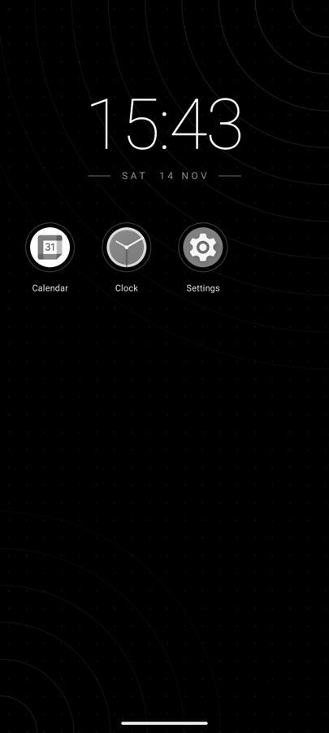
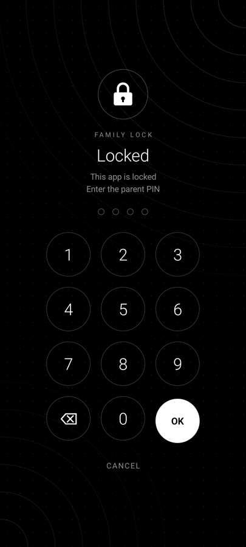
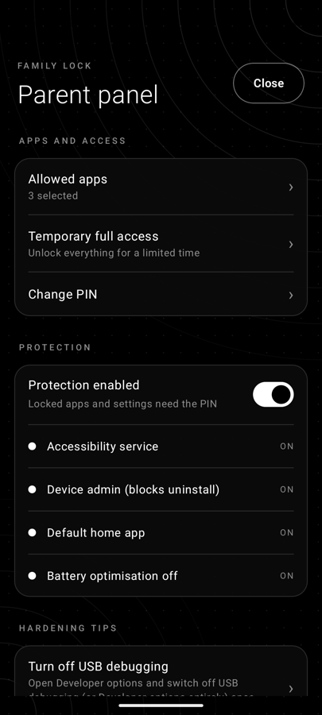
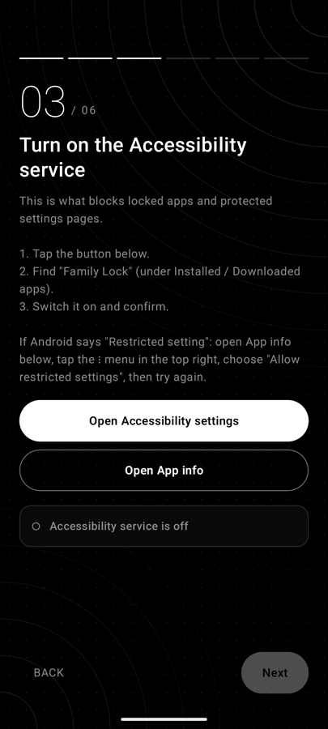
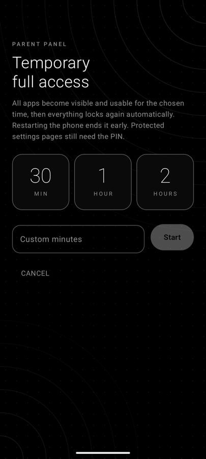
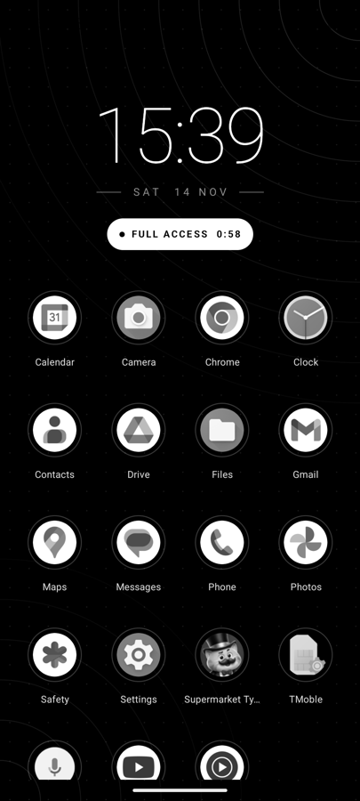

# Family Lock Launcher

A minimalist black-and-white Android home launcher with an app lock, for personal/family use.
Sideload only (not for the Play Store). Kotlin + Jetpack Compose, Android 8.0+ (min SDK 26).

**Download:** get the latest APK from the [Releases page](https://github.com/Dipendra-creator/family-lock-launcher/releases/latest).

| Home | Lock screen | Parent panel |
|---|---|---|
|  |  |  |

| Setup | Timer | Full access |
|---|---|---|
|  |  |  |

It works **without Device Owner mode** (no factory reset, no account removal) by combining:

| Piece | What it does |
|---|---|
| Launcher (HOME app) | Shows only the allowed apps |
| Accessibility service | Puts a PIN screen over locked apps and protected settings pages |
| Device Admin | Stops the app being uninstalled |

## Project structure

```
app/src/main/
├── AndroidManifest.xml
├── res/xml/accessibility_service_config.xml   accessibility service settings
├── res/xml/device_admin.xml                   device admin declaration
└── java/com/familylock/launcher/
    ├── Config.kt               MASTER_CODE and PIN length  <-- change the master code here
    ├── App.kt                  loads settings at process start
    ├── MainActivity.kt         launcher + onboarding + parent panel (navigation)
    ├── Apps.kt                 lists / launches installed apps
    ├── Status.kt               "is accessibility / admin / default home / battery OK?"
    ├── SystemActions.kt        opens the system settings pages
    ├── data/SettingsStore.kt   DataStore persistence
    ├── data/LockManager.kt     PIN check, temporary-access timer, shared state
    ├── lock/BlockRules.kt      which screens are protected  <-- extend for other brands
    ├── lock/LockAccessibilityService.kt   the blocking engine
    ├── lock/PinOverlay.kt      full-screen PIN keypad drawn over blocked apps
    ├── lock/AdminReceiver.kt   device admin
    ├── lock/BootReceiver.kt    re-locks after reboot
    └── ui/                     Compose screens (home, PIN pad, onboarding, parent panel)
```

## Build

**Android Studio:** File > Open > select this folder, wait for sync, then
Build > Build APK(s). The APK is written to `app/build/outputs/apk/debug/app-debug.apk`.

**Command line** (JDK 17+, Android SDK with platform 36):

```
./gradlew assembleDebug      # app/build/outputs/apk/debug/app-debug.apk
./gradlew assembleRelease    # app/build/outputs/apk/release/app-release.apk
```

**Release signing:** create `keystore.properties` in the project root (it is git-ignored):

```
storeFile=../release.keystore
storePassword=...
keyAlias=...
keyPassword=...
```

Without that file, release builds are signed with the debug key. Android only installs an
update over an existing copy if it is signed with the **same key**, so keep your keystore safe.

**Before building for your own family, change `MASTER_CODE` in `Config.kt`** - the default
value is public in this repository.

## Install on a phone

- **By file:** copy the APK to the phone, tap it, and allow "Install unknown apps".
- **By USB:** enable USB debugging, then `adb install -r app/build/outputs/apk/debug/app-debug.apk`.

Open **Family Lock** and follow the 6 setup steps (PIN, allowed apps, accessibility
service, device admin, default home, battery).

Notes:
- Android 13+ may show "Restricted setting" when enabling the accessibility service for a
  sideloaded app. Open App info for Family Lock > ⋮ menu > **Allow restricted settings**.
- Xiaomi / Vivo / Oppo / Realme: also enable **Autostart** and set battery to
  **No restrictions** in App info, or the system may stop the service.
- Turn off **USB debugging** when you are done (adb can remove the app).

## Daily use

- **Parent panel:** long-press the clock on the home screen, enter the PIN.
- **Master code:** `993311` works on every PIN screen and takes you straight to "set a new PIN".
- **Temporary full access:** parent panel > Temporary full access. Ends on its own, and
  ends immediately if the phone restarts.
- **Uninstall:** parent panel > Deactivate device admin, then uninstall from App info.
- **Last resort:** Safe Mode disables the app (accepted weakness / recovery path).

## Behaviour worth knowing

- Protected settings pages (Accessibility, Device admin, this app's App info, Developer
  options, Default apps / home app, Date & time, the uninstall dialog) ask for the PIN
  **even during temporary full access** and even when Settings is an allowed app.
  Otherwise a child could use that time to remove the app.
- A correct PIN unlocks that one app until you leave it. A wrong PIN, Cancel or Back
  returns to the home screen.
- Pages opened from the parent panel stay unlocked for 2 minutes so the parent is not
  asked twice.
- Protected pages are recognised by English window titles and class names. For another
  language or an unusual brand, set `DEBUG = true` in `LockAccessibilityService.kt`, run
  `adb logcat -s FamilyLock`, open the page, and add its title or class to `BlockRules.kt`.

## Testing checklist

| # | Test | Expected |
|---|---|---|
| 1 | Home screen after setup | Only allowed apps are shown |
| 2 | Open a hidden app from a notification, Recents, a link or the share sheet | PIN screen appears over it |
| 3 | On that PIN screen: wrong PIN / Cancel / Back | Returns to the launcher |
| 4 | On that PIN screen: correct PIN | App opens; locked again after leaving it |
| 5 | Settings (if allowed) > Accessibility, Device admin apps, Developer options, Date & time, Default apps | PIN screen on each; other pages (e.g. Wi-Fi) open normally |
| 6 | Settings > Apps > Family Lock (App info) | PIN screen (no Force stop / Clear data) |
| 7 | Try to uninstall Family Lock (App info, long-press, `adb uninstall`) | Blocked; uninstall dialog is PIN-locked, adb reports a device-policy failure |
| 8 | Parent panel > Temporary full access > 1 custom minute | All apps appear with a countdown; after 1 minute everything re-locks, even an app that is open |
| 9 | Change the phone's date/time during temporary access | Date & time page is PIN-locked; countdown is unaffected |
| 10 | Start 30 min of temporary access, then restart the phone | Locked immediately after boot; service is running again |
| 11 | Enter `993311` on any PIN screen | "Set a new PIN" appears, then the parent panel |
| 12 | Turn the accessibility service off, press Home | Full-screen warning asking for the PIN |
| 13 | Parent panel > Protection enabled off, then on | Off: everything visible and open. On: locked again |
| 14 | Parent panel > Change PIN | Old PIN is refused, new PIN works |
| 15 | Parent panel > Deactivate device admin | The app can then be uninstalled |
